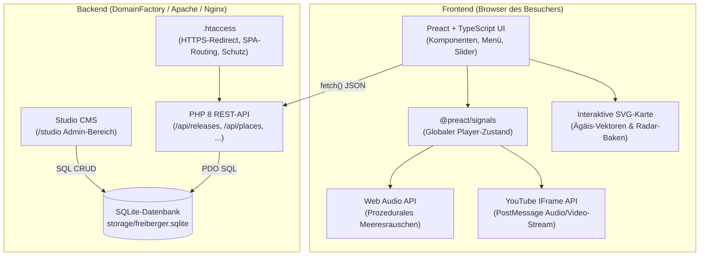

# Technische Architekturbeschreibung: freiberger.music

Dieses Dokument bietet einen verständlichen, technischen Überblick über die Architektur, Technologien und Design-Entscheidungen der Web-Applikation **freiberger.music** (Audiovisuelles Künstlerarchiv & Digitales Label).

---

## 🏛️ Gesamtsystem im Überblick

Die Anwendung basiert auf dem Architektur-Muster einer **Single Page Application (SPA)** im Frontend, gekoppelt mit einer schlanken **PHP 8 / SQLite REST-API** als serverseitige Datenquelle.

---

## 1. Das Frontend (Die Benutzeroberfläche)

### ⚛️ Preact (statt klassischem React)
- **Was ist das?** Eine moderne Benutzeroberflächen-Bibliothek, die fast 1:1 wie das bekannte Facebook-Framework *React* funktioniert, aber **nur ca. 3 Kilobyte** groß ist (React wiegt über 40 KB).
- **Warum Preact?** Wir schreiben modernen Komponenten-Code (`HeroStage.tsx`, `PlayerBar.tsx`, `ReleaseSlider.tsx`), die Website lädt aber auf Smartphones und Tablets **zehnmal schneller** als normale Web-Apps, weil kaum JavaScript über die Leitung übertragen werden muss.

### ⚡ @preact/signals (Zustandsverwaltung / State Management)
- **Was ist das?** Früher brauchte man für geteilte Daten (z. B. welcher Song gerade spielt) schwere Bibliotheken wie Redux. *Signals* sind reaktive Datenbehälter: z. B. `isPlaying.value = true`.
- **Warum genial?** Wenn du in der Player-Leiste auf Pause klickst, rendert der Browser **nicht** die ganze Seite neu. Das Signal aktualisiert *chirurgisch genau* nur das kleine Play/Pause-Icon im DOM – flüssig mit 60 Bildern pro Sekunde.

### 🛡️ TypeScript (TSX)
- **Was ist das?** JavaScript mit festen Typdefinitionen. Anstatt dass Daten unkontrolliert fließen, weiß der Code genau, welche Felder ein Track hat (`id`, `title`, `duration`, `youtube_id`, `bpm`).
- **Warum?** Verhindert Tippfehler und Abstürze bereits beim Schreiben des Codes.

### ⚡ Vite (Das Build-System)
- **Was ist das?** Das derzeit modernste und schnellste Entwicklungswerkzeug im Web.
- **Was macht es?** Es nimmt unsere Dutzenden TypeScript-, CSS- und Preact-Dateien, packt sie zusammen, entfernt unnötige Leerzeichen (Minification) und erzeugt in unter einer Sekunde zwei winzige, extrem optimierte Produktionsdateien (`index.js` und `index.css`).

---

## 2. Audio, Video & Grafik: Die multimedialen Besonderheiten

### 🌊 Web Audio API (Der browser-eigene Klangerzeuger)
- **Datei:** `frontend/src/player/ambientSound.ts`
- **Wie funktioniert das?** Wenn du auf das Wellen-Symbol `[ 🌊 Ägäis Ambient ]` klickst, wird **keine Audio-Datei** aus dem Internet heruntergeladen! 
- Stattdessen nutzt der Browser den mathematischen Audio-Synthesizer des Betriebssystems: Wir erzeugen „Pink Noise“ (weiches Rauschen) und führen es durch einen zeitgesteuerten Tiefpass-Filter (LFO mit ca. 8,5 Sekunden Zyklus). Dadurch schwillt das Rauschen auf und brandet sanft ab – genau wie echte Meereswellen an einem Ägäis-Kieselstrand.
- **Vorteil:** Null Datenverbrauch, keine Ladezeiten, absolut unendliche Endlosschleife ohne störende Schnittkante.

### 🎬 YouTube IFrame API & PostMessage-Fernsteuerung
- **Dateien:** `frontend/src/player/playerStore.ts` & `frontend/src/components/YouTubeFacade.tsx`
- **Wie funktioniert das?** Wir betten YouTube datenschutzkonform ein (2-Click-Lösung über `youtube-nocookie.com`).
- Über den Parameter `enablejsapi=1` öffnen wir einen bidirektionalen Kommunikationskanal (`window.postMessage`). Dadurch können unsere eigenen goldenen Buttons (`⏮`, `▶`, `⏭`, Scrubber) dem YouTube-Video Befehle wie `playVideo`, `pauseVideo` oder `seekTo` zurufen.
- Gleichzeitig sendet YouTube sekündlich den aktuellen Fortschritt an unsere Player-Leiste zurück, sodass Zeit und Scrubber millimetergenau synchron mitlaufen.

### 🗺️ Interaktive SVG-Vektorkarte (Griechenland / Ägäis)
- **Datei:** `frontend/src/components/GreeceMap.tsx`
- **Was ist SVG?** *Scalable Vector Graphics*. Das ist kein Pixel-Foto (wie JPG oder PNG), sondern eine mathematische Zeichnung aus Vektorpfaden.
- **Vorteil:** Die Karte ist auf einem 4K-Bildschirm genauso gestochen scharf wie auf einem kleinen Smartphone, wiegt aber nur wenige Kilobyte. Die Radar-Baken und Koordinaten der Inseln reagieren direkt auf Mausbewegungen und ändern in Echtzeit die Lichtstimmung der gesamten Seite.

---

## 3. Das Backend (Der Server)

### 🐘 PHP 8 (REST-Schnittstelle)
- **Dateien:** `api/index.php`, `api/config.php`
- **Aufgabe:** Reines JSON-Backend. Wenn das Frontend Daten braucht, ruft es z. B. `https://freiberger.music/api/releases` auf. PHP holt die Tracks aus der Datenbank und liefert sie als saubere JSON-Struktur aus.
- **Vorteil:** Minimalistisch, keine schweren Frameworks nötig, funktioniert auf jedem Standard-Webhosting.

### 🗄️ SQLite (Datenbank)
- **Datei:** `storage/freiberger.sqlite`
- **Was ist SQLite?** Im Gegensatz zu MySQL braucht SQLite keinen eigenen Server-Dienst, keine Benutzerkonten und keine Ports. Die gesamte relationale Datenbank (inklusive aller Tabellen für Tracks, Schauplätze, Buchkapitel und Benutzer) ist eine **einzige, kompakte Datei** (`freiberger.sqlite`).
- **Vorteil:** Für Backups oder Serverumzüge kopiert man einfach die eine Datei. Zudem ist SQLite extrem schnell, weil keine Netzwerk-Verbindung zu einem externen Datenbank-Server aufgebaut werden muss.

### 🔒 Apache Webserver-Konfiguration (`.htaccess`)
- **Aufgabe:**
  1. **HTTPS-Erzwingung:** Leitet alle ungesicherten `http://`-Aufrufe per 301-Permanent-Redirect auf `https://` um.
  2. **Sicherheit & Schutz:** Verhindert, dass jemand die Datenbank `storage/freiberger.sqlite` oder PHP-Konfigurationsdateien direkt im Browser herunterladen kann.
  3. **SPA-Routing:** Wenn ein Nutzer direkt auf `https://freiberger.music/places/naxos` geht, leitet Apache die Anfrage intern auf die `index.html` weiter, damit der clientseitige Router von Preact die Ansicht ohne 404-Fehler öffnen kann.
  4. **Zertifikatsvalidierung:** Lässt Anfragen für Let's Encrypt / ACME (`.well-known/acme-challenge/`) ohne Umleitung direkt passieren.

---

## 4. Paketierung & Deployment-Workflow

### 📦 Automatisches Packaging (`scripts/package-domainfactory.js`)
- Mit dem Befehl `npm run package` (im `frontend/`-Ordner) wird:
  1. Der TypeScript-Code überprüft (`tsc`)
  2. Das Produktions-Build via Vite erstellt
  3. Die fertigen Assets nach Root kopiert
  4. Ein deployment-fertiger Ordner `deploy-domainfactory/` sowie eine ZIP-Datei `deploy-domainfactory.zip` erzeugt, die alle notwendigen Produktionsdateien (ohne Node-Module oder Quellcode-Ballast) enthält.
